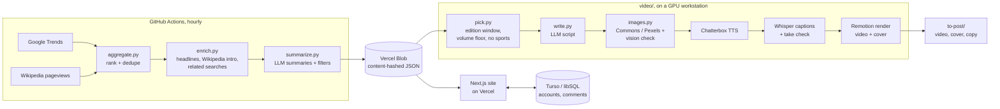

# By the Zeitgeist

**What the U.S. is searching and reading, right now.** A news site built from
attention data instead of editors, plus a pipeline that turns the same data
into a narrated, captioned vertical news video three times a day.

**Live:** [bythezeitgeist.com](https://bythezeitgeist.com)

- **The site** ranks Google Trends searches and Wikipedia pageviews into
  *Trending now*, *Today*, *This week* and *This month*. Every topic gets a
  one-line summary, a short brief and source links, and the full archive goes
  back to Sept 25, 2026, browsable by day.
- **The videos** are a ~60-second "Top 5" Short for each edition (morning,
  midday, evening, weekly, monthly). A model writes the script from the site's
  headlines, each story gets a license-checked photo, a cloned public-domain
  voice narrates it, and Remotion renders it with word-timed captions.

## How it works



More detail, and the reasoning behind the main decisions, is in
[docs/ARCHITECTURE.md](docs/ARCHITECTURE.md).

## Tech

| Area | Stack |
|---|---|
| Site | Next.js 15 (App Router, server components, intercepting-route modals), React 19, TypeScript, Tailwind 4 |
| Data | Python 3, `requests` only; Google Trends + Wikipedia Pageviews APIs; GitHub Actions cron |
| Storage | Vercel Blob (content-hashed files + a manifest), Turso / libSQL |
| Auth | Email one-time codes (Resend) + bcrypt passwords, Google OAuth, encrypted JWT cookies (`jose`) |
| LLMs | OpenAI GPT-5.4 nano for summaries; Kimi K2.7 via OpenCode for scripts and photo checks, behind one small adapter (`zeitgeist/llm.py`) |
| Video | Remotion 4, Chatterbox (zero-shot voice cloning), faster-whisper alignment, ffmpeg |
| Integrations | TikTok Content Posting API (Login Kit + Direct Post) |

## Repo layout

```
web/         Next.js site: lists, story pages, day archive, search, comments, sign-in
zeitgeist/   hourly data pipeline: sources, ranking, enrichment, summaries, Blob sync
video/       news-Short pipeline: pick, write, photos, voice, captions, render
docs/        architecture and design decisions
.github/     the hourly pipeline workflow
```

Each folder has its own README with setup and details:
[web](web/README.md) · [zeitgeist](zeitgeist/README.md) · [video](video/README.md)

## A few things worth a look

- **Captions keep the script's exact text.** Whisper supplies only the
  timing, and its words are aligned back onto the script with `difflib`, so
  names and punctuation are never misheard
  ([`video/pipeline/captions.py`](video/pipeline/captions.py)).
- **Automatic take check.** Every narration is transcribed and compared with
  the script. A take that drops or garbles words is re-recorded once before
  rendering ([`video/pipeline/check.py`](video/pipeline/check.py)).
- **Photos that match the story.** Candidates come only from license-filtered
  Wikimedia Commons (PD / CC0 / CC BY / CC BY-SA) and Pexels. A vision model
  scores each one against the story and suggests better searches when nothing
  fits, and credits go into every post
  ([`video/pipeline/images.py`](video/pipeline/images.py)).
- **A cheap, cache-friendly data layer.** The pipeline writes each file under
  its content hash, and the site re-reads only the manifest, at most once a
  minute ([`web/lib/store.ts`](web/lib/store.ts),
  [`zeitgeist/blob/sync.mjs`](zeitgeist/blob/sync.mjs)).
- **Summaries with guardrails.** Banned-phrase and "talks about its sources"
  filters, a retry that tells the model what it got wrong, and flags that let
  the site hide sports, junk and non-English topics
  ([`zeitgeist/summarize.py`](zeitgeist/summarize.py)).
